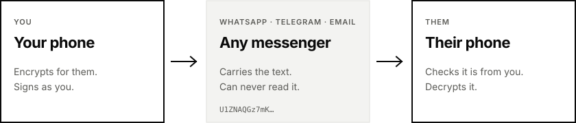

<div align="center">

<picture>
  <source media="(prefers-color-scheme: dark)" srcset="assets/readme/header-dark.svg">
  
</picture>

### Private messages over any messenger.

Svoboda encrypts on your phone with post-quantum cryptography.<br>
WhatsApp, iMessage or Slack carry the result. Only the person you wrote to can read it.

<br>

[](https://expo.dev/accounts/oblivionware/projects/svoboda/builds)
&nbsp;
[](#ios)

[](https://csrc.nist.gov/pubs/fips/203/final)
[](https://csrc.nist.gov/pubs/fips/204/final)
[](https://expo.dev)
[](LICENSE)

</div>

<br>

> [!WARNING]
> **Not yet reviewed.** The message format has not had an independent security review. Use Svoboda to try it out, not to protect anything that matters.

<br>

## How it works

<picture>
  <source media="(prefers-color-scheme: dark)" srcset="assets/readme/how-it-works-dark.svg">
  
</picture>

|  |  |
|---|---|
| **Create your identity** | Your phone generates a key pair. The private key never leaves it. |
| **Add someone** | Meet in person and scan each other's code. Compare fingerprints out loud. |
| **Send** | Pick who it's to, write, tap *Copy encrypted*, paste it into any chat. |
| **Receive** | Copy what they sent, pick who it's from, tap *Paste and decrypt*. |

*Svoboda* means freedom in most Slavic languages.

<br>

## Which messengers work

A Svoboda message is plain text made of letters, digits, `+` and `/`, so any app that delivers text unchanged can carry it. What decides it is length. Post-quantum keys and signatures are big: even a one-word message comes out at about **5,900 characters**, and every 3 bytes of what you write add 4 more (a Latin letter is 1 byte, a Cyrillic or Greek letter 2, an emoji 4). A message has to arrive in one piece: Svoboda can't put one back together from parts.

| Messenger | Works | Why |
|---|---|---|
| **WhatsApp** | Yes | Takes about 65,000 characters per message. |
| **iMessage** | Yes | No published limit between Apple devices. Not when it falls back to SMS (green bubbles), see SMS. |
| **Facebook Messenger** | Yes | Takes about 20,000 characters per message. |
| **Slack** | Yes | Takes 40,000 characters per message. |
| **Microsoft Teams** | Yes | Takes about 28 KB per post. |
| **Element** and other Matrix apps | Yes | Takes about 64 KB per message. |
| **Telegram** | No | Caps a message at 4,096 characters, well short of 5,900, so it can't arrive in one piece. |
| **Discord** | No | Caps a message at 2,000 characters, or 4,000 with Nitro. Both are too short. |
| **SMS** | No | A long text is sent as parts of 153 characters each, so a message would need about 39 of them. Many carriers cap how many parts they deliver or convert long texts, and the parts don't reliably arrive whole. |
| **Signal** | Untested | No published limit. Long messages may be handled differently from short ones. Try it before relying on it. |
| **Threema** | Untested | Older versions of the app split long messages into several, which would break a Svoboda message. The app's current limit isn't published. |
| **Viber** | Untested | No published limit for personal chats. |

Limits come from each service's documentation where it publishes one, otherwise from developer and support sources, as of October 2026. Messengers change their limits; if a message won't decrypt, check that it arrived complete.

<br>

## Under the hood

| | |
|---|---|
| **Encryption** | ML-KEM-768 (FIPS 203) agrees a fresh key for every message |
| **Signatures** | ML-DSA-65 (FIPS 204) proves who wrote it |
| **Message cipher** | XChaCha20-Poly1305, keyed through HKDF-SHA256 |
| **Your keys** | Kept in the phone's keychain, never synced to another device |
| **Contacts** | Public keys only, stored on your phone. No servers, no accounts |

<details>
<summary><b>Message format</b></summary>

<br>

Each message is base64 text you can paste anywhere:

```
header ("SVM" · version · suite) │ ML-KEM-768 ciphertext │ nonce │ XChaCha20-Poly1305 ciphertext │ ML-DSA-65 signature
```

Both people's fingerprints are authenticated with the message, so it only opens for the person it was written to, and only when checked against the person who wrote it. The suite byte leaves room for new algorithms, such as FN-DSA once FIPS 206 is final, without breaking existing contacts.

A short message comes out at about 5,900 characters. See [Which messengers work](#which-messengers-work) for where that fits.

Source: [`src/lib/message.ts`](src/lib/message.ts), [`src/lib/contact-card.ts`](src/lib/contact-card.ts).

</details>

<br>

## Install

### Android

1. On your phone, open the [Android download](https://expo.dev/accounts/oblivionware/projects/svoboda/builds) and download the APK.
2. Open it. If Android asks, allow your browser or file manager to install unknown apps.
3. Tap **Install**.

Updates install the same way and keep your identity and contacts.

### iOS

Svoboda isn't on the App Store. You can sideload it with your own Apple ID, at no cost:

With a free Apple ID, a sideloaded app stops opening after 7 days unless it's refreshed. That's what sets the tools apart:

| | Computer needed | Refreshing every 7 days | Best for |
|---|---|---|---|
| **[SideStore](https://sidestore.io)** · *recommended* | Only for the first setup | On the phone, anywhere with internet | Using Svoboda day to day |
| **[Sideloadly](https://sideloadly.io)** | Every install | Sideload it again from the computer | Trying Svoboda once |
| **[AltStore](https://altstore.io)** | Setup and every refresh | Automatic, while the computer is on the same Wi-Fi | People who already use AltStore |

**We recommend SideStore** because Svoboda only helps if it opens when a message arrives. After a one-time setup, SideStore refreshes the app on the phone itself, so it doesn't quietly stop working because a computer was out of reach that week. Its setup takes longer than the others; if you only want to try Svoboda, Sideloadly is the quickest start.

1. Install SideStore (or Sideloadly) by following its own guide.
2. Download `Svoboda-<version>-unsigned.ipa` from the [latest release](https://github.com/TzvetomirTz/svoboda/releases/latest).
3. Open it with that app and sign in with your Apple ID when asked.

> [!NOTE]
> Your identity and contacts stay on the phone as long as you don't delete the app, even if a refresh is missed. A free Apple ID can have three sideloaded apps at a time. These tools sometimes break for a while after an iOS update; check their pages if installing fails.

Have a Mac with Xcode? You can also [build it from source onto your iPhone](#build-it-onto-your-iphone-with-xcode).

<br>

## For developers

<details>
<summary><b>Run it locally</b></summary>

<br>

```bash
nvm use            # Node 24 LTS
npm install
npx expo start     # then scan the QR code with Expo Go
```

Run `npx tsc --noEmit` and `npx expo lint` before committing. After changing an icon master in `assets/`, run `npm run icons`.

</details>

<a id="build-it-onto-your-iphone-with-xcode"></a>
<details>
<summary><b>Build it onto your iPhone with Xcode</b></summary>

<br>

Builds Svoboda from source and installs it on your iPhone, signed with your own Apple ID. Needs a Mac with Xcode and a USB cable.

**Once, on the Mac**

```bash
sudo xcodebuild -license accept
xcodebuild -runFirstLaunch
brew install cocoapods
```

1. In **Xcode → Settings → Apple Accounts**, add your Apple ID. A free one works.
2. Select it, open **Manage Certificates…**, click **+** and choose **Apple Development**.
3. Let `codesign` use that certificate without asking. Otherwise macOS asks for your password once for every framework it signs:
   ```bash
   security set-key-partition-list -S apple-tool:,apple:,codesign: -s ~/Library/Keychains/login.keychain-db
   ```
   Enter your Mac login password. It prints every item in your keychain; let it finish.

**Once, on the iPhone**

1. Connect it by USB, unlock it and tap **Trust This Computer**.
2. Turn on **Settings → Privacy & Security → Developer Mode**. The phone restarts. If the option isn't there, open Xcode once with the phone connected.

**Build and install**

```bash
npm install
npx expo run:ios --device --configuration Release
```

Pick your iPhone from the list. The first build takes 5–15 minutes; later ones take a few. `Release` puts the JavaScript inside the app, so it runs without the Mac or Metro.

The first time, iOS won't open the app until you trust your certificate: **Settings → General → VPN & Device Management →** your Apple ID **→ Trust**.

With a free Apple ID the app stops opening after 7 days. Connect the phone and run the same command again; your identity and contacts are kept.

**If it fails**

| Error | Fix |
|---|---|
| `No code signing certificates are available to use` | Check `security find-identity -v -p codesigning`. If it finds 0 valid identities but Xcode lists your certificate, the Apple WWDR G3 intermediate is missing. Download [`AppleWWDRCAG3.cer`](https://www.apple.com/certificateauthority/AppleWWDRCAG3.cer) and open it to add it to your login keychain. |
| Bundle identifier can't be registered | `com.oblivionware.svoboda` belongs to another team. Change `ios.bundleIdentifier` in `app.json` to something of your own, then run `npx expo prebuild --clean -p ios`. |
| Keychain password prompts that don't go away | Press Ctrl+C, run the `set-key-partition-list` command above, then build again. |
| `invalid code signature … not been explicitly trusted` | The app is installed. Trust your certificate on the iPhone, as above. |

</details>

<details>
<summary><b>Make a release</b></summary>

<br>

1. Set the new version in `app.json` (`expo.version`).
2. Commit, then tag and push:
   ```bash
   git tag v1.0.0
   git push origin v1.0.0
   ```
   The **iOS release** workflow builds the unsigned `.ipa` and attaches it to a draft GitHub Release for the tag. The tag must match the version in `app.json`.
3. Build the Android APK:
   ```bash
   npx eas-cli@latest build --platform android --profile release
   ```
4. Download the APK from EAS, rename it `Svoboda-<version>.apk` and add it to the draft release.
5. Publish the release.

EAS keeps the Android signing key. Every update must be signed with the same key, so keep a backup (`npx eas-cli@latest credentials`). If it's lost, people have to uninstall Svoboda, and lose their identity and contacts, to update.

</details>

<br>

---

<div align="center">

<sub>Powered by <b>OblivionWare</b> · <a href="LICENSE">MIT License</a></sub>

</div>
